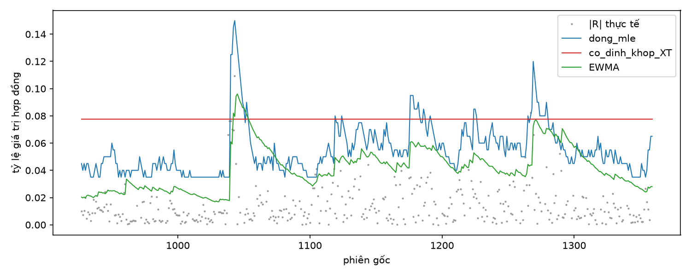
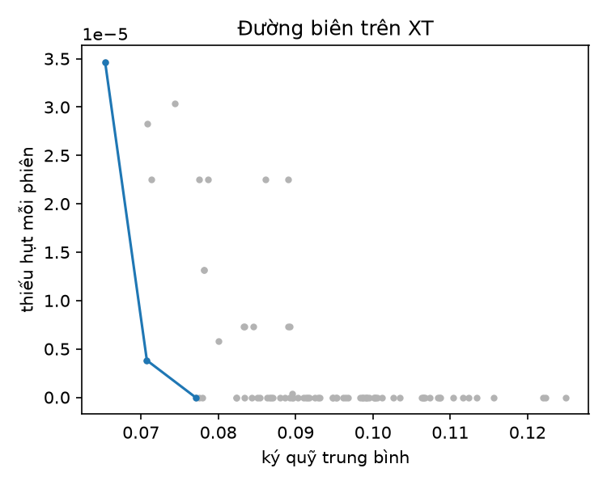

# Kết quả theo đề cương EGARCH-X ký quỹ động (hồ sơ: day_du)

Sinh tự động lúc 2026-10-24 17:28. Hồ sơ `nhanh` chỉ để kiểm tra đường ống.

## 1. Dữ liệu (mục 2)

2171 phiên, 2017-11-06 – 2026-07-17; 105 phiên chuyển hợp đồng; 0 phiên khóa biên; c_rho (UL) = 1.4728.

| Khối | Từ | Đến | Số phiên | Phiên chuyển |
|---|---|---|---|---|
| UL | 2018-01-31 | 2021-01-28 | 750 | 36 |
| XT | 2021-01-29 | 2024-10-16 | 925 | 44 |
| KT | 2024-10-17 | 2026-07-17 | 435 | 22 |

## 2. Kiểm tra cài đặt và đối chiếu độc lập (Phụ lục A, C.5)

Bảng 11 lệch lớn nhất 0.00046; đối chiếu gói arch: EGARCH chênh tham số lớn nhất 0.0004, MCS trùng tập = True, SPA cùng kết luận = True.

### Cỡ và lực của các kiểm định (mô phỏng, N = khối KT)

| Kiểm định | Tỷ lệ bác bỏ 5% | Sai số MC |
|---|---|---|
| berkowitz|co | 0.0510 | 0.0031 |
| christoffersen|a0.01|co | 0.0214 | 0.0020 |
| christoffersen|a0.025|co | 0.0276 | 0.0023 |
| christoffersen|a0.05|co | 0.0494 | 0.0031 |
| dm|ar1 | 0.0858 | 0.0040 |
| dm|iid | 0.0576 | 0.0033 |
| dq_hac|a0.01|H2 | 0.1258 | 0.0047 |
| dq_hac|a0.01|H3 | 0.0910 | 0.0041 |
| dq_hac|a0.025|H2 | 0.0836 | 0.0039 |
| dq_hac|a0.025|H3 | 0.1000 | 0.0042 |
| dq_hac|a0.05|H2 | 0.0658 | 0.0035 |
| dq_hac|a0.05|H3 | 0.0750 | 0.0037 |
| dq|a0.01|co | 0.1596 | 0.0052 |
| dq|a0.025|co | 0.0818 | 0.0039 |
| dq|a0.05|co | 0.0628 | 0.0034 |
| gw|iid | 0.0490 | 0.0031 |
| kupiec|a0.01|co | 0.0256 | 0.0022 |
| kupiec|a0.01|luc | 0.3780 | 0.0069 |
| kupiec|a0.025|co | 0.0720 | 0.0037 |
| kupiec|a0.025|luc | 0.8242 | 0.0054 |
| kupiec|a0.05|co | 0.0492 | 0.0031 |
| kupiec|a0.05|luc | 0.9778 | 0.0021 |

## 3. Mô phỏng khôi phục tham số bằng MLE (mục 4.4)

| Cấu hình | theta chệch | theta độ phủ | beta độ phủ | bác bỏ theta=0 | bác bỏ gamma=0 |
|---|---|---|---|---|---|
| chuan|mle|E1 | -0.0009 | 0.9400 | 0.9450 | 1.0000 | 1.0000 |
| chuan|mle|E2 | -0.0000 | 0.9500 | 0.9410 | 0.0500 | 1.0000 |
| chuan|mle|E3 | -0.0004 | 0.9350 | 0.9480 | 1.0000 | 1.0000 |
| chuan|mle|E4 | -0.0014 | 0.9430 | 0.9350 | 1.0000 | 0.0620 |
| ged|mle|E1 | -0.0020 | 0.9460 | 0.9530 | 1.0000 | 1.0000 |
| ged|mle|E2 | -0.0006 | 0.9450 | 0.9440 | 0.0550 | 1.0000 |
| ged|mle|E3 | -0.0009 | 0.9430 | 0.9330 | 1.0000 | 1.0000 |
| ged|mle|E4 | -0.0015 | 0.9310 | 0.9430 | 0.9990 | 0.0620 |
| skewt|mle|E1 | -0.0008 | 0.9560 | 0.9390 | 0.9990 | 1.0000 |
| skewt|mle|E2 | -0.0012 | 0.9520 | 0.9390 | 0.0480 | 1.0000 |
| skewt|mle|E3 | -0.0021 | 0.9370 | 0.9390 | 0.9980 | 1.0000 |
| skewt|mle|E4 | -0.0021 | 0.9350 | 0.9340 | 0.9990 | 0.0620 |
| student|mle|E1 | -0.0009 | 0.9490 | 0.9420 | 1.0000 | 1.0000 |
| student|mle|E2 | -0.0006 | 0.9330 | 0.9310 | 0.0670 | 1.0000 |
| student|mle|E3 | -0.0006 | 0.9530 | 0.9350 | 0.9990 | 1.0000 |
| student|mle|E4 | -0.0007 | 0.9450 | 0.9430 | 1.0000 | 0.0470 |

*Mô phỏng Bayes và SBC (b03b) đang chạy; báo cáo sẽ được làm lại khi xong.*

## 4. MLE trên khối UL (mục 4.2)

**chuan|A+G**: logL = -1253.19, AIC = 2526.39, BIC = 2572.59, LR(gamma=0) p = 0.0000, 17/20 điểm khởi tạo về cùng nghiệm.

| Tham số | Ước lượng | SE Hessian | SE bánh kẹp |
|---|---|---|---|
| mu | 0.0107 | 0.0391 | 0.0402 |
| omega | 0.1043 | 0.0273 | 0.0477 |
| kappa | 0.0655 | 0.0772 | 0.1041 |
| theta | -0.2255 | 0.0413 | 0.0632 |
| beta | 0.7624 | 0.0504 | 0.0766 |
| gamma_A | -0.1134 | 0.0315 | 0.0464 |
| gamma_G | 0.3039 | 0.0673 | 0.0978 |
| delta_dh | 0.5677 | 0.2467 | 0.3063 |
| delta_sau | -0.3702 | 0.2461 | 0.3136 |
| delta_nghi | 2.0159 | 0.4864 | 0.7610 |

**student|A+G**: logL = -1203.03, AIC = 2428.05, BIC = 2478.88, LR(gamma=0) p = 0.0003, 19/20 điểm khởi tạo về cùng nghiệm.

| Tham số | Ước lượng | SE Hessian | SE bánh kẹp |
|---|---|---|---|
| mu | 0.0630 | 0.0324 | 0.0326 |
| omega | 0.0904 | 0.0492 | 0.0579 |
| kappa | 0.1636 | 0.0938 | 0.0917 |
| theta | -0.1970 | 0.0550 | 0.0619 |
| beta | 0.7579 | 0.0762 | 0.0954 |
| gamma_A | -0.0686 | 0.0400 | 0.0412 |
| gamma_G | 0.2960 | 0.0946 | 0.1085 |
| delta_dh | 0.7094 | 0.3199 | 0.3211 |
| delta_sau | -0.3486 | 0.3126 | 0.3060 |
| delta_nghi | 1.7769 | 0.7764 | 1.1241 |
| nu | 4.2194 | 0.6648 | 0.7107 |

**skewt|A+G**: logL = -1197.15, AIC = 2418.30, BIC = 2473.74, LR(gamma=0) p = 0.0001, 20/20 điểm khởi tạo về cùng nghiệm.

| Tham số | Ước lượng | SE Hessian | SE bánh kẹp |
|---|---|---|---|
| mu | 0.0072 | 0.0370 | 0.0375 |
| omega | 0.0941 | 0.0465 | 0.0528 |
| kappa | 0.1387 | 0.0826 | 0.0769 |
| theta | -0.1776 | 0.0499 | 0.0549 |
| beta | 0.7718 | 0.0708 | 0.0856 |
| gamma_A | -0.0852 | 0.0374 | 0.0404 |
| gamma_G | 0.2946 | 0.0914 | 0.1049 |
| delta_dh | 0.6987 | 0.3137 | 0.3298 |
| delta_sau | -0.3686 | 0.3013 | 0.3064 |
| delta_nghi | 1.5914 | 0.6811 | 0.8323 |
| nu | 4.4743 | 0.7564 | 0.7780 |
| lambda | -0.1746 | 0.0508 | 0.0512 |

**ged|A+G**: logL = -1207.68, AIC = 2437.37, BIC = 2488.19, LR(gamma=0) p = 0.0002, 19/20 điểm khởi tạo về cùng nghiệm.

| Tham số | Ước lượng | SE Hessian | SE bánh kẹp |
|---|---|---|---|
| mu | 0.0648 | 0.0068 | 0.0016 |
| omega | 0.0826 | 0.0390 | 0.0441 |
| kappa | 0.1223 | 0.0996 | 0.0963 |
| theta | -0.2141 | 0.0553 | 0.0600 |
| beta | 0.7567 | 0.0726 | 0.0829 |
| gamma_A | -0.0868 | 0.0407 | 0.0403 |
| gamma_G | 0.3035 | 0.0933 | 0.0995 |
| delta_dh | 0.7044 | 0.3302 | 0.3016 |
| delta_sau | -0.3986 | 0.3233 | 0.2983 |
| delta_nghi | 1.8798 | 0.6845 | 0.8809 |
| nu | 1.1126 | 0.0721 | 0.0884 |

### Kiểm tra dự báo tiên nghiệm (mục 4.3.1): phân vị của thống kê dữ liệu trong phân phối dự báo tiên nghiệm

| Phân phối | độ lệch chuẩn | độ nhọn | max |r| | chạm chặn ln h |
|---|---|---|---|---|
| chuan | 0.2130 | 0.0840 | 0.1460 | 0.5560 |
| student | 0.1930 | 0.0740 | 0.1440 | 0.5530 |
| skewt | 0.2130 | 0.0510 | 0.1540 | 0.5610 |
| ged | 0.1890 | 0.0690 | 0.1370 | 0.5800 |

## 5. Chọn biến và phân phối trên XT (mục 6)

Tập biến được chọn: **G**; SPA p = 0.2225; Holm: {'G': 5.310829415128282e-07, 'F': 0.0919450415405203, 'B': 0.5894986226348657, 'A': 0.5894986226348657, 'O': 0.7503896580190077}; VIF: [1.0].
Phân phối được chọn: **ged**.

## 6. Cổng chuyển giai đoạn (mục 8.1)

(i) True; (ii) True; (iii) True; tổng: **True**.

## 7. Độ nhạy tiên nghiệm (mục 4.3.1): chênh lệch trung bình hậu nghiệm theo đơn vị độ lệch chuẩn gốc

| Phương án | mu | omega | kappa | theta | beta | gamma_G | delta_dh | delta_sau | delta_nghi | nu |
|---|---|---|---|---|---|---|---|---|---|---|
| rong |  |  |  |  |  |  |  |  |  |  |
| hep |  |  |  |  |  |  |  |  |  |  |

## 8. Đánh giá ngoài mẫu trên KT (2024-10-17 – 2026-07-17) (mục 5)

| Mô hình | QLIKE | LS | Vi phạm 1% | Kupiec p | FZ0 2,5% | Berkowitz p |
|---|---|---|---|---|---|---|
| MLE|ged|EGARCH | 1.6062 | -1.5277 | 5 | 0.7596 | 1.4770 | 0.3578 |
| MLE|ged|A+G | 1.6612 | -1.5225 | 5 | 0.7596 | 1.4821 | 0.3340 |
| MLE|chuan|G | 1.6319 | -1.6630 | 7 | 0.2407 | 1.5401 | 0.2671 |
| MLE|student|G | 1.6552 | -1.5084 | 5 | 0.7596 | 1.4597 | 0.1587 |
| MLE|skewt|G | 1.6435 | -1.5092 | 4 | 0.8642 | 1.4511 | 0.1518 |
| MLE|ged|G | 1.6602 | -1.5224 | 5 | 0.7596 | 1.4802 | 0.3201 |
| MLE|ged|GARCH | 1.5745 | -1.5328 | 5 | 0.7596 | 1.5230 | 0.4326 |
| vb_mf|ged|G | 1.6435 | -1.5212 | 5 | 0.7596 | 1.4583 | 0.3176 |
| vb_fr|ged|G | 1.6472 | -1.5211 | 5 | 0.7596 | 1.4711 | 0.2671 |
| nuts|ged|G | 1.6465 | -1.5210 | 5 | 0.7596 | 1.4758 | 0.2922 |

Tập mô hình tin cậy: {'LS': ['MLE|ged|EGARCH', 'MLE|ged|A+G', 'MLE|chuan|G', 'MLE|student|G', 'MLE|skewt|G', 'MLE|ged|G', 'MLE|ged|GARCH', 'vb_mf|ged|G', 'vb_fr|ged|G', 'nuts|ged|G'], 'QLIKE': ['MLE|ged|EGARCH', 'MLE|ged|A+G', 'MLE|chuan|G', 'MLE|student|G', 'MLE|skewt|G', 'MLE|ged|G', 'MLE|ged|GARCH', 'vb_mf|ged|G', 'vb_fr|ged|G', 'nuts|ged|G'], 'FZ0_0.01': ['MLE|ged|EGARCH', 'MLE|ged|A+G', 'MLE|chuan|G', 'MLE|student|G', 'MLE|skewt|G', 'MLE|ged|G', 'MLE|ged|GARCH', 'vb_mf|ged|G', 'vb_fr|ged|G', 'nuts|ged|G'], 'FZ0_0.025': ['MLE|ged|EGARCH', 'MLE|ged|A+G', 'MLE|chuan|G', 'MLE|student|G', 'MLE|skewt|G', 'MLE|ged|G', 'MLE|ged|GARCH', 'vb_mf|ged|G', 'vb_fr|ged|G', 'nuts|ged|G']}

CH1 (EGARCH-X so với EGARCH): {'LS': {'t': -0.7298924267078507, 'p_mot_phia_goc_tot_hon': 0.23272797093844022}, 'QLIKE': {'t': 1.598298660103588, 'p_mot_phia_goc_tot_hon': 0.9450117372636805}, 'FZ0_0.01': {'t': 0.43752181985957483, 'p_mot_phia_goc_tot_hon': 0.6691335223256123}, 'FZ0_0.025': {'t': 0.06420050860613773, 'p_mot_phia_goc_tot_hon': 0.5255947137884814}}

### So sánh bốn phương pháp tại mốc cuối (s0 = 2155): tỷ số độ lệch chuẩn so với NUTS

| Phương pháp | mu | omega | kappa | theta | beta | gamma_G | delta_dh | delta_sau | delta_nghi | nu |
|---|---|---|---|---|---|---|---|---|---|---|
| mle | 1.1417 | 1.0444 | 0.9354 | 1.0997 | 1.1202 | 1.1377 | 0.9778 | 1.0198 | 1.4608 | 1.3744 |
| vb_mf | 0.9219 | 0.4945 | 0.7914 | 0.9250 | 0.3356 | 0.3853 | 0.5974 | 0.6615 | 0.9780 | 1.0053 |
| vb_fr | 0.9781 | 0.9334 | 1.0413 | 0.9917 | 0.9612 | 0.8887 | 0.9915 | 0.9703 | 0.9619 | 0.9557 |

## 9. Ký quỹ động (mục 7), thiết kế trình bày H2|a0.01

Siêu tham số chọn trên XT: {'w': 0.0, 'b': 0.0, 'phi': 0.5, 'eta': 0.0}.

| Quy tắc | m tb | Tỷ lệ vượt | Thiếu hụt tb | Cùng m_tb: thiếu hụt/phiên | DM p |
|---|---|---|---|---|---|
| dong_mle | 0.0579 | 0.0092 | 0.0170 | 0.0002 | 0.5000 |
| dong_egarch_mle | 0.0575 | 0.0092 | 0.0208 | 0.0002 | 0.0894 |
| dong_vb_mf | 0.0595 | 0.0115 | 0.0135 | 0.0002 | 0.1942 |
| dong_vb_fr | 0.0578 | 0.0115 | 0.0165 | 0.0002 | 0.1365 |
| dong_nuts | 0.0573 | 0.0092 | 0.0170 | 0.0002 | 0.5767 |
| dong_mle_khong_nguong | 0.0514 | 0.0161 | 0.0165 | 0.0002 | 0.2809 |
| VaR_tho_mle | 0.0482 | 0.0207 | 0.0174 | 0.0002 | 0.1433 |
| FHS_EGARCH-X | 0.0555 | 0.0115 | 0.0238 | 0.0003 | 0.1262 |
| EWMA | 0.0412 | 0.0415 | 0.0162 | 0.0003 | 0.1115 |
| lich_su_cua_so | 0.0566 | 0.0184 | 0.0297 | 0.0005 | 0.1435 |
| co_dinh_khop_XT | 0.0775 | 0.0046 | 0.0184 | 0.0004 | 0.1007 |
| VSD_hang_so | 0.1700 | 0.0000 | 0.0000 | 0.0004 | 0.1007 |
| VSD_lich_su | 0.1700 | 0.0000 | 0.0000 | 0.0004 | 0.1007 |
| moc_tren_H_x_bien_do | 0.1400 | 0.0000 | 0.0000 | 0.0004 | 0.1007 |

